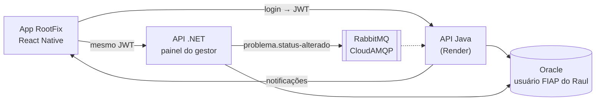
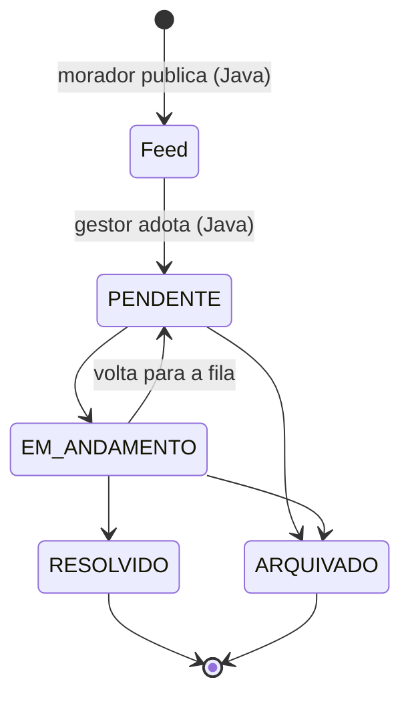

# 🌱 RootFix — API .NET (painel do gestor)

> Global Solution 2026/2 · CitizenTech · FIAP 2TDS · **Advanced Business Development with .NET**
> Grupo **Rooted**

O **RootFix** é zeladoria urbana por comunidade. Gestores (associações de bairro ou secretarias) criam
comunidades; moradores entram nas comunidades perto de casa, publicam problemas (buraco, lâmpada
queimada, bueiro entupido), apoiam e comentam os dos vizinhos. O gestor **adota** os problemas que vai
acompanhar e cuida do status deles pelo painel.

Esta API é o **painel do gestor**: cuida de tudo **depois da adoção**. Ela é consumida pelo mesmo app
React Native que consome a API Java e usa o **mesmo banco Oracle** e o **mesmo login (JWT)**.

| | |
|---|---|
| **Cidadão beneficiado** | O morador, que publica um problema e hoje não sabe se alguém está cuidando dele |
| **Valor entregue por esta API** | Status e prioridade gerenciados pelo gestor, com histórico; o morador acompanha cada etapa e lê os recados do gestor; o gestor decide pelo que tem mais apoio e mede o tempo de resolução |
| **ODS** | 11 (cidades sustentáveis), 9 (infraestrutura), 10 (redução das desigualdades) |

| 🌐 | |
|---|---|
| **API no ar (Swagger)** | https://rootfix-api-dotnet.onrender.com |
| **Health check** | https://rootfix-api-dotnet.onrender.com/health |
| **Login (API Java)** | https://rootfix-java.onrender.com/swagger-ui.html → `POST /auth/login` |

> Plano gratuito do Render: depois de 15 min sem uso a API dorme e o primeiro acesso leva alguns segundos.

---

## 👥 Integrantes

| Nome | RM | Responsabilidade |
|---|---|---|
| Ryan Vetoriano | RM565667 | **.NET (este repositório)** |
| João Caetano | RM562074 | Java e DevOps |
| João Bueno | RM564115 | IA e QA |
| Felipe Furlanetto | RM562766 | Mobile |
| Raul Rezende | RM564002 | Banco de Dados |

---

## 🎯 Requisitos da disciplina → onde estão

| # | Requisito (PDF) | Pts | Onde está |
|---|---|---|---|
| 01 | Minimal API RESTful, validações, códigos HTTP | 20 | [`Endpoints/`](RootFix.API/Endpoints) (só Minimal API, sem controllers) · [`ValidacaoFilter`](RootFix.API/Filters/ValidacaoFilter.cs) · [`GlobalExceptionHandler`](RootFix.API/Errors/GlobalExceptionHandler.cs) (400, 401, 403, 404, 409, 422, 429, 500) |
| 02 | OpenAPI / Swagger | (01) | Swagger na raiz `/`, com descrição, contratos, respostas, Bearer e `Idempotency-Key` — [`SwaggerExtensions`](RootFix.API/Extensions/SwaggerExtensions.cs) |
| 03 | Idempotência | 15 | Cabeçalho `Idempotency-Key` gravado no Oracle — [`IdempotenciaFilter`](RootFix.API/Filters/IdempotenciaFilter.cs) + [`EfIdempotenciaStore`](RootFix.Infrastructure/Idempotencia/EfIdempotenciaStore.cs) |
| 04 | Rate limiting com 429 | 15 | Middleware nativo `Microsoft.AspNetCore.RateLimiting`, por usuário — [`RateLimitingExtensions`](RootFix.API/Extensions/RateLimitingExtensions.cs) |
| 05 | JWT + autorização | 20 | Valida o token da API Java; política `Gestor` + dono da comunidade — [`AuthenticationExtensions`](RootFix.API/Extensions/AuthenticationExtensions.cs) |
| 05 | Health checks (API, banco, serviços externos) | 10 | `/health`, `/health/live`, `/health/ready` — Oracle, API Java, RabbitMQ — [`HealthChecks`](RootFix.API/HealthChecks/HealthChecks.cs) |
| 06 | Testes xUnit (unitários + integração) | 20 | [`tests/`](tests) — **158 testes** (66 unitários, 92 de integração) |
| — | ASP.NET Minimal API + **EF Core** | obrigatório | EF Core 10 + `Oracle.EntityFrameworkCore` |

---

## 🏗️ Arquitetura



**Divisão de responsabilidades** (plano de ação do grupo): a API **Java** cuida de tudo até a adoção
(cadastro, login, comunidades, feed, apoios, observações, adoção, notificações). A API **.NET** cuida de
tudo depois dela (status, prioridade, indicadores e o acompanhamento pelo morador).

### Camadas (mesma estrutura do projeto FutureVet)

```
RootFix.Domain          Entidades, regras (máquina de estados do status), exceções de domínio
RootFix.Application     Serviços, DTOs, interfaces (repositórios, idempotência, mensageria)
RootFix.Infrastructure  EF Core + Oracle, repositórios, store de idempotência, RabbitMQ
RootFix.API             Minimal API: endpoints, JWT, filtros, rate limiting, health, Swagger
tests/                  RootFix.UnitTests (xUnit + Moq) · RootFix.IntegrationTests (WebApplicationFactory)
```

Dependências apontam para dentro: `API → Application ← Infrastructure`, e tudo → `Domain`.
Cada camada registra as próprias dependências (`AddApplication()`, `AddInfrastructure()`).

### Vida de um problema



As transições ficam no domínio ([`TransicaoDeStatus`](RootFix.Domain/Rules/TransicaoDeStatus.cs)) e
são testadas sem banco. Toda mudança grava o `RF_HISTORICO_STATUS` na mesma transação do `UPDATE`. Só a API .NET escreve
nessa tabela: o DDL do grupo garante que nenhum procedimento ou gatilho PL/SQL insere nela.

---

## 📋 Endpoints

Todos exigem `Authorization: Bearer <JWT da API Java>`, exceto os health checks.

### Painel do gestor — perfil `GESTOR`, e só da própria comunidade

| Método | Rota | Para quê |
|---|---|---|
| `GET` | `/painel/comunidades` | Comunidades do gestor, com contagem por status |
| `GET` | `/painel/comunidades/{comunidadeId}/supervisionados` | Adotados, paginados. Filtros: `status`, `prioridade`, `semPrioridade`, `titulo`. Ordem: `ordenarPor=adotadoEm\|apoios\|prioridade\|gravidade\|criadoEm`, `direcao=asc\|desc`. Paginação: `pagina`, `tamanhoPagina` (máx. 50) |
| `GET` | `/painel/comunidades/{comunidadeId}/indicadores` | Por status, por prioridade, tempo médio de resolução (h), taxa de resolução, 5 abertos mais apoiados |
| `GET` | `/painel/problemas/{problemaId}` | Detalhe com a linha do tempo de status |
| `PATCH` | `/painel/problemas/{problemaId}/status` | Muda o status. **Exige `Idempotency-Key`** |
| `PATCH` | `/painel/problemas/{problemaId}/prioridade` | Define a prioridade (`Idempotency-Key` opcional) |

### Morador — qualquer perfil autenticado, membro da comunidade

| Método | Rota | Para quê |
|---|---|---|
| `GET` | `/problemas/{problemaId}/acompanhamento` | Situação do problema, frase pronta para o app e linha do tempo com os recados do gestor |

### Infraestrutura (públicos)

| Rota | O que verifica |
|---|---|
| `GET /health` | Tudo: API, Oracle, API Java, RabbitMQ (se configurado) |
| `GET /health/live` | Só o processo (para o Render / orquestrador) |
| `GET /health/ready` | API + dependências |
| `POST /dev/token` | **Só em Development**: gera um JWT de teste. Não existe em produção |

### Exemplos

```http
PATCH /painel/problemas/42/status
Authorization: Bearer eyJhbGciOi...
Idempotency-Key: 6f1c2b8e-3d0a-4c55-9b7e-0e2f9d3a1c11
Content-Type: application/json

{ "status": "EM_ANDAMENTO", "observacao": "Equipe agendada para 20/11" }
```

```json
200 OK
{
  "problemaId": 42,
  "statusAnterior": "PENDENTE",
  "statusNovo": "EM_ANDAMENTO",
  "dataHora": "2026-11-16T14:03:11-03:00",
  "observacao": "Equipe agendada para 20/11",
  "historicoId": 7,
  "proximosStatusPossiveis": ["RESOLVIDO", "ARQUIVADO", "PENDENTE"]
}
```

```json
422 Unprocessable Entity   (application/problem+json)
{
  "title": "Regra de negócio violada",
  "status": 422,
  "detail": "Não é permitido mudar o status de PENDENTE para RESOLVIDO. A partir de PENDENTE são permitidos: EM_ANDAMENTO, ARQUIVADO.",
  "instance": "PATCH /painel/problemas/42/status",
  "correlationId": "c0a8..."
}
```

### Códigos HTTP

| Código | Quando |
|---|---|
| 200 | Sucesso |
| 400 | Validação (campo obrigatório, tamanho, página, ordenação), JSON malformado, enum inválido, `Idempotency-Key` ausente |
| 401 | Token ausente, expirado, com assinatura ou emissor inválidos |
| 403 | Morador no painel; gestor de outra comunidade; morador de fora da comunidade |
| 404 | Problema ou comunidade inexistente |
| 409 | Status igual ao atual; edição simultânea; mesma `Idempotency-Key` ainda em processamento |
| 422 | Regra de negócio (transição proibida, problema não adotado, prioridade em problema encerrado); `Idempotency-Key` reutilizada com outro conteúdo |
| 429 | Limite de requisições (com `Retry-After`) |

---

## 🔐 Autenticação (JWT da API Java)

O gestor faz login **uma vez**, na API Java (`POST /auth/login`), e usa o mesmo token aqui. A API .NET
**não emite** tokens: ela só **valida** o que o `TokenService` do Java gera.

| Item | Emitido pelo Java | Validado pelo .NET |
|---|---|---|
| Algoritmo | HS256 | Só HS256 (outro algoritmo → 401) |
| Chave | Bytes UTF-8 do `JWT_SECRET` (32+ caracteres) | O mesmo `JWT_SECRET` |
| Emissor (`iss`) | `JWT_ISSUER`, padrão `rootfix-api` | Igual ao configurado (outro → 401) |
| Expiração (`exp`) | 480 min | Validada, com 30 s de tolerância de relógio |
| Usuário (`sub`) | ID numérico de `RF_USUARIO` | Lido como ID (não numérico → 403) |
| Perfil (`perfil`) | `GESTOR` ou `MORADOR` | Vira o papel exigido pela política `Gestor` |

As duas APIs leem as **mesmas variáveis de ambiente** (`JWT_SECRET` e `JWT_ISSUER`), então não tem como
ficarem com valores diferentes. **Autorização em duas camadas:** a política `Gestor` barra moradores no
painel, e o serviço confere no banco se o gestor é **dono daquela** comunidade.

### Testando com as contas da API Java

Com `DADOS_INICIAIS=true`, a API Java cria as contas de teste (senha `Rootfix@2026`):

| Perfil | E-mail | Uso no painel .NET |
|---|---|---|
| Gestor | `gestor@rootfix.com` | Painel completo da comunidade dele |
| Morador | `morador@rootfix.com` | `GET /problemas/{id}/acompanhamento`; no painel recebe 403 |

1. `POST https://rootfix-java.onrender.com/auth/login` com o e-mail e a senha → copie o `token`.
2. No Swagger desta API, clique em **Authorize** e cole o token.
3. Use `GET /painel/comunidades` para ver o ID da comunidade e seguir para os supervisionados.

## 🕒 Fuso horário

Combinado do grupo: **todas as datas no horário de Brasília** (UTC−03:00, sem horário de verão desde 2019).

| Onde | Como |
|---|---|
| Oracle | Colunas `TIMESTAMP` sem fuso, guardando a hora de Brasília |
| API Java | `LocalDateTime.now()` segue o fuso da JVM: no Render, `TZ=America/Sao_Paulo` no ambiente (o container roda em UTC) |
| API .NET | [`RelogioDoRootFix`](RootFix.Application/Common/RelogioDoRootFix.cs) grava a hora de Brasília em qualquer máquina, sem depender do fuso do container |
| JSON do .NET | Datas com offset explícito: `"2026-11-13T15:00:00-03:00"` ([`DataHoraComFusoConverter`](RootFix.API/Extensions/DataHoraComFusoConverter.cs)) |
| Scripts | `CAST(SYSTIMESTAMP AT TIME ZONE 'America/Sao_Paulo' AS TIMESTAMP)`: não depende do fuso do servidor Oracle |

Por que importa: o tempo médio de resolução subtrai `ADOTADO_EM` (gravado pelo Java) de `DATA_HORA`
(gravado pelo .NET). Com fusos diferentes, cada problema ganharia 3 horas a mais ou a menos. O fuso é
configurável em `FusoHorario` no `appsettings.json`.

## ♻️ Idempotência

O caso real: o gestor toca em "Resolvido", a rede do celular cai antes da resposta e o app reenvia. Sem
idempotência, a repetição gravaria outro histórico e dispararia outra rodada de notificações.

| Situação | Resposta |
|---|---|
| Chave nova | Executa e guarda a resposta de sucesso |
| Mesma chave + mesmo conteúdo | Devolve a resposta guardada, **sem executar de novo**, com `Idempotent-Replayed: true` |
| Mesma chave + outro corpo ou outra rota | `422` |
| Mesma chave enquanto a primeira ainda roda | `409` |
| A operação falhou (4xx/5xx) | A reserva é desfeita; o app pode tentar de novo com a mesma chave |

- As chaves ficam no **Oracle** (`RF_IDEMPOTENCIA`), não em memória: o Render gratuito desliga
  a instância depois de 15 min parada, justamente quando o app costuma reenviar.
- A reserva é **atômica** (índice único `UK_RF_IDEMPOTENCIA` em `CHAVE + ID_USUARIO`): duas
  requisições simultâneas com a mesma chave gravam uma vez só (há teste para isso).
- Enquanto a operação roda, a linha fica com `STATUS_HTTP = 102` (HTTP *Processing*); ao terminar,
  recebe o status e a `RESPOSTA` que serão repetidos. `ROTA` guarda método e caminho, e
  `IMPRESSAO_DIGITAL` o SHA-256 de método + rota + corpo, que detecta a chave reutilizada.
- As chaves são **por usuário** e valem **24 h** a partir de `CRIADO_EM` (configurável).
- Defesa extra: `Status` é **token de concorrência** no EF Core (`UPDATE ... WHERE STATUS = <lido>`).
  Dois gestores mudando ao mesmo tempo → o segundo recebe `409`, em vez de sobrescrever.

## 🚦 Rate limiting

| Política | Algoritmo | Padrão | Onde |
|---|---|---|---|
| `leitura` | Janela fixa | 60/min por usuário | `GET` do painel e acompanhamento |
| `escrita` | Token bucket | 10 fichas, +10/min por usuário | `PATCH` de status e prioridade |

Particionado pela claim do usuário (sem token, pelo IP). Ao estourar: `429` + `Retry-After` +
ProblemDetails. Health checks não são limitados. Limites ajustáveis na seção `RateLimiting`.

## ❤️ Health checks

| Check | Falha resulta em | Por quê |
|---|---|---|
| `api` | — | O processo está vivo |
| `oracle` | Unhealthy | Sem banco a API não funciona |
| `api-java` | Degraded | O Java no Render dorme; o painel continua útil |
| `rabbitmq` | Degraded | O status continua sendo gravado no Oracle |

A resposta lista nome, status, descrição e duração de cada check — nunca connection strings.

---

## 🚀 Como executar

### Pré-requisitos

- .NET SDK 10
- Acesso ao Oracle do grupo (usuário FIAP do Raul) com o DDL oficial aplicado

### 1. Configurar os segredos (nunca no repositório)

```bash
cd RootFix.API
dotnet user-secrets set "ConnectionStrings:OracleConnection" "User Id=RM_DO_RAUL;Password=SENHA;Data Source=oracle.fiap.com.br:1521/ORCL"
dotnet user-secrets set "Jwt:SigningKey" "<o mesmo JWT_SECRET da API Java>"
```

Opcional: `RabbitMq:Uri` (CloudAMQP), para publicar `problema.status-alterado` também localmente.

### 2. Banco de dados

| Script | Quando usar |
|---|---|
| [`scripts/script-bd.sql`](scripts/script-bd.sql) | DDL oficial do grupo (o mesmo do Java e do DevOps), já com a coluna `IMPRESSAO_DIGITAL`. **Apaga e recria** as tabelas `RF_` |
| [`scripts/alteracao-rf-idempotencia.sql`](scripts/alteracao-rf-idempotencia.sql) | Só se o DDL oficial já foi rodado **sem** `IMPRESSAO_DIGITAL`: acrescenta a coluna |
| [`scripts/dados-demo-painel.sql`](scripts/dados-demo-painel.sql) | Opcional: gestora, moradores, comunidade e problemas em cada status. Imprime os IDs para usar no `/dev/token` |

### 3. Rodar

```bash
dotnet run --project RootFix.API
```

Swagger em `http://localhost:5279`. Sem o login do Java, gere um token em `POST /dev/token`
(`{ "usuarioId": <ID da gestora impresso pelo dados-demo-painel.sql>, "perfil": "GESTOR" }`), clique em
**Authorize** e cole o token.

> Sem `Jwt:SigningKey` configurada, em Development a API sobe com uma chave temporária: o `/dev/token`
> funciona, mas tokens do Java não são aceitos.

### 4. Testes

```bash
dotnet test
```

Não precisa de Oracle nem de credenciais (veja [Testes](#-testes)).

---

## ☁️ Deploy no Render (para o app)

**Decisão (adendo 1):** Render gratuito, num **workspace diferente do da API Java**, com Docker. A API
precisa ficar no ar **até 30/11** (correção de Mobile). Cada workspace gratuito tem 750 h/mês, o que
cobre um único serviço ligado o mês todo; no mesmo workspace do Java, os dois juntos estourariam.

| Item | Valor |
|---|---|
| Serviço | Web Service, runtime **Docker**, plano **Free** |
| Imagem | [`Dockerfile`](Dockerfile) da raiz (SDK 10 para compilar, ASP.NET 10 para rodar, usuário sem privilégio) |
| Configuração | [`render.yaml`](render.yaml) (Blueprint): o Render cria o serviço a partir dele |
| Branch | `main`, com deploy automático a cada push |
| Health check | `/health/live` (só o processo; não derruba o deploy se o Oracle oscilar) |
| Memória | GC de estação de trabalho e heap limitado a 70%: ~75–95 MB em uso (o plano gratuito tem 512 MB) |
| Partida | Código pré-compilado (ReadyToRun): sobe em ~19 s com 0,1 CPU, contra ~85 s sem ele |

### Passo a passo

1. Garanta que o código está na `main` do GitHub: o Render faz o deploy a partir dela.
2. No Render, crie um **workspace novo** (menu do workspace → *Create workspace*), separado do da API Java.
3. *New → Blueprint* → conecte o GitHub → escolha este repositório. O Render lê o [`render.yaml`](render.yaml).
4. Preencha os segredos que ele pedir:

| Variável | Valor |
|---|---|
| `ConnectionStrings__OracleConnection` | `User Id=<RM do Raul>;Password=<senha>;Data Source=oracle.fiap.com.br:1521/ORCL` |
| `JWT_SECRET` | **Exatamente o mesmo valor** do serviço da API Java |
| `RABBITMQ_URL` | A mesma URL `amqps://...` do CloudAMQP do serviço da API Java |

`JWT_ISSUER=rootfix-api` já vem no Blueprint. O health check da API Java
(`https://rootfix-java.onrender.com/actuator/health`) já vem no `appsettings.json`, porque não é segredo.
O Render informa a porta pela variável `PORT`, que a API já usa.

5. Depois do primeiro deploy, confira:
   - `https://rootfix-api-dotnet.onrender.com/health` → `oracle` e `api-java` *Healthy* (ou `api-java` *Degraded* se o Java estiver dormindo);
   - `https://rootfix-api-dotnet.onrender.com/` → Swagger;
   - login no Java com `gestor@rootfix.com` e `GET /painel/comunidades` com o token (ver [Autenticação](#-autenticação-jwt-da-api-java)).
6. Passe a URL para o Felipe (app) e coloque-a em [Links](#-links).

### Cuidados com o plano gratuito

- O serviço **dorme após 15 min sem uso** e leva cerca de 1 minuto para acordar. Antes de demonstrar ou de
  o professor testar, abra `/health/live` uma vez. O app deve mostrar "conectando ao servidor" na
  primeira chamada, em vez de erro.
- Como o workspace é só desta API, dá para mantê-la acordada com um monitor externo gratuito (ex.:
  UptimeRobot) chamando `/health/live` a cada 10 min: um serviço ligado o mês inteiro (~720 h) cabe
  nas 750 h do workspace.
- O build do Docker no plano gratuito leva alguns minutos; cada push na `main` gera um deploy novo.

---

## 🧪 Testes

```bash
dotnet test                                   # tudo
dotnet test tests/RootFix.UnitTests           # 66 unitários
dotnet test tests/RootFix.IntegrationTests    # 92 de integração
```

Padrão **AAA** (Arrange, Act, Assert) e nomes `Metodo_Cenario_ResultadoEsperado`.

**Unitários** (xUnit + Moq, sem banco): máquina de estados de status, regras da entidade `Problema`
(transições, status repetido, problema não adotado, observação, prioridade em problema encerrado) e os
serviços (autorização por comunidade, publicação do evento, falha da fila sem desfazer a mudança,
cálculo dos indicadores e do tempo médio, acompanhamento pelo morador, desconexão do app logo após o
commit sem transformar sucesso em erro).

**Integração** (`WebApplicationFactory<Program>`): a API inteira sobe em memória — pipeline HTTP, JWT,
filtros, rate limiting, EF Core, health checks — e os testes chamam os endpoints por HTTP. Cobrem:

- 401 (sem token, assinatura errada, expirado, emissor errado, algoritmo diferente de HS256), 403
  (morador, outro gestor, token sem `perfil`, `sub` não numérico) e um token **idêntico ao do
  `TokenService` do Java** sendo aceito;
- fluxo completo de status, 422 para transição proibida, 409 para status repetido, 400 para enum e
  JSON inválidos e para validação de campos;
- idempotência: chave ausente, repetição, chave com outro corpo, chave em outro problema, reuso após
  falha, chaves de usuários diferentes e **5 requisições simultâneas com a mesma chave → 1 gravação**;
- filtros, ordenação e paginação dos supervisionados; parâmetros inválidos → 400;
- indicadores, acompanhamento do morador, 429 com `Retry-After` (por usuário e, sem token, por IP),
  health checks (inclusive API Java fora do ar → `Degraded`), Swagger (parâmetros, enums, respostas e
  health checks documentados) e correlation ID;
- **contrato com o Java**: o JSON do evento sai exatamente no formato combinado, e o modelo do EF Core
  é conferido coluna a coluna contra o [`scripts/script-bd.sql`](scripts/script-bd.sql) (se uma coluna
  for renomeada no DDL, o teste aponta qual).

**Banco nos testes:** SQLite (arquivo temporário, uma conexão por requisição, como o pool do Oracle) com o **mesmo modelo do EF Core** (entidades, mapeamentos, token
de concorrência, chaves estrangeiras e índice único). O Oracle é compartilhado pelo grupo; assim os testes
rodam em qualquer máquina, sem credenciais e sem sujar o banco do grupo. O publicador do RabbitMQ é
trocado por um que guarda os eventos em memória, para o teste verificar o que seria enviado ao Java.

---

## 🧩 Integração com as outras matérias

| Com quem | O que esta API espera / entrega |
|---|---|
| **Java** | Mesmo segredo do JWT. Na adoção grava `ADOTADO = 1`, `ADOTADO_EM` e `STATUS = 'PENDENTE'` (o `CK_RF_PROBLEMA_ADOCAO` exige). Consome `problema.status-alterado` para notificar |
| **Banco (Raul)** | Lê `RF_USUARIO`, `RF_COMUNIDADE`, `RF_PARTICIPACAO`, `RF_CATEGORIA`, `RF_APOIO`. Escreve `RF_PROBLEMA` (só `STATUS` e `PRIORIDADE`), `RF_HISTORICO_STATUS` e `RF_IDEMPOTENCIA` |
| **Mobile** | Swagger desta API; enviar `Idempotency-Key` (UUID) no PATCH de status; tratar 429 e o cold start do Render |
| **QA** | Casos negativos prontos: status inválido, transição proibida, gestor de outra comunidade, morador no painel, chave repetida |

### Evento `problema.status-alterado`

Publicado no RabbitMQ depois que a mudança de status é gravada, no formato combinado com o listener
do Java (ele busca no Oracle o restante para aplicar a regra de notificação):

```json
{ "problemaId": 12, "statusAnterior": "PENDENTE", "statusNovo": "EM_ANDAMENTO", "observacao": "A equipe vai amanhã cedo" }
```

`observacao` vai `null` quando o gestor não deixa recado. Exchange `rootfix.eventos` (topic) e routing
key `problema.status-alterado`, iguais ao `RabbitConfig` do Java, que liga essa chave à fila
`rootfix.problema.status-alterado`. Se a fila estiver fora do ar, a
mudança **não** é desfeita (o histórico no Oracle é a fonte da verdade): fica só um aviso no log.

---

## ⏳ Pontos em aberto (combinar com o grupo)

Já resolvidos pelo DDL oficial: nomes das tabelas e colunas, colunas `ID_USUARIO` e `OBSERVACAO` no
histórico, conflito com o PL/SQL (nenhum procedimento ou gatilho grava em `RF_HISTORICO_STATUS`), status
obrigatório na adoção, valores de `GRAVIDADE_IA`, tabela de idempotência e o adendo 2 (o .NET publica o
evento). Fechados com o repositório da API Java: o contrato do JWT, a exchange/routing key do RabbitMQ e o
fuso das datas (horário de Brasília; falta só a variável no ambiente do Java). A hospedagem também
está decidida (Render, workspace próprio, [Deploy](#️-deploy-no-render-para-o-app)).
O que falta:

| # | Ponto | Com quem | Padrão atual | Onde ajustar |
|---|---|---|---|---|
| 1 | Coluna `IMPRESSAO_DIGITAL` em `RF_IDEMPOTENCIA` no Oracle do grupo | Raul | Já no [`script-bd.sql`](scripts/script-bd.sql) deste repositório | [`alteracao-rf-idempotencia.sql`](scripts/alteracao-rf-idempotencia.sql) |
| 2 | `CHECK` em `RF_PROBLEMA.PRIORIDADE` (`URGENTE/ALTA/MEDIA/BAIXA`) | Raul | Sem CHECK no DDL; só a API .NET grava, sempre com esses valores | — (sugestão) |
| 3 | `TZ=America/Sao_Paulo` no ambiente da API Java (Render e Azure) | João Caetano | Sem isso, o Java grava em UTC no Render | Variável de ambiente, sem código ([Fuso horário](#-fuso-horário)) |
| 4 | `DEFAULT` das colunas de data usa `SYSTIMESTAMP` (fuso do servidor) | Raul | As APIs sempre informam a data, então o padrão só vale para INSERT manual | Trocar por `CAST(SYSTIMESTAMP AT TIME ZONE 'America/Sao_Paulo' AS TIMESTAMP)` (sugestão) |


---

## 🛠️ Tecnologias

.NET 10 · ASP.NET Core Minimal API · EF Core 10 · Oracle.EntityFrameworkCore · JWT Bearer ·
Microsoft.AspNetCore.RateLimiting · HealthChecks · Swashbuckle (OpenAPI) · Serilog · RabbitMQ.Client 7 ·
xUnit · Moq · WebApplicationFactory · SQLite (testes) · Docker

## 🤖 Declaração de uso de IA generativa

_preencher: ferramentas usadas e para quê, conforme a regra da Global Solution._

## 🔗 Links

- Repositório: https://github.com/ryanvetoriano/RootFix
- API no ar: https://rootfix-api-dotnet.onrender.com (Swagger na raiz)
- Health check: https://rootfix-api-dotnet.onrender.com/health
- API Java (login e token): https://rootfix-java.onrender.com
- Vídeo: _se houver_
