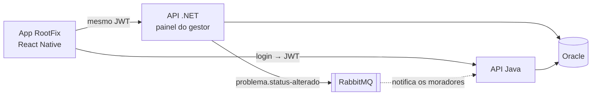
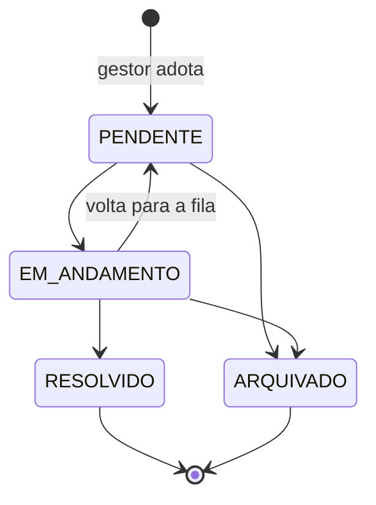

# 🌱 RootFix — API .NET (painel do gestor)

> Global Solution 2026/2 · CitizenTech · FIAP 2TDS · **Advanced Business Development with .NET**
> Grupo **Rooted**

O **RootFix** é zeladoria urbana por comunidade. Gestores (associações de bairro ou secretarias) criam
comunidades; moradores entram nas comunidades perto de casa, publicam problemas (buraco, lâmpada
queimada, bueiro entupido), apoiam e comentam os dos vizinhos. O gestor **adota** os problemas que vai
acompanhar e cuida do status deles pelo painel.

Esta API é o **painel do gestor**: cuida de tudo **depois da adoção** — status, prioridade, indicadores
e o acompanhamento do problema pelo morador. Ela é consumida pelo app RootFix (React Native) e usa o
mesmo banco Oracle e o mesmo login (JWT) da API Java do projeto.

| | |
|---|---|
| **Cidadão beneficiado** | O morador, que publica um problema e hoje não sabe se alguém está cuidando dele |
| **Valor entregue por esta API** | O gestor organiza o que adotou (status, prioridade, indicadores) e o morador acompanha cada etapa, com os recados do gestor |
| **ODS** | 11 (cidades sustentáveis), 9 (infraestrutura), 10 (redução das desigualdades) |

| 🌐 | |
|---|---|
| **API no ar (Swagger)** | https://rootfix-api-dotnet.onrender.com |
| **Health check** | https://rootfix-api-dotnet.onrender.com/health |
| **Login (API Java)** | https://rootfix-java.onrender.com/swagger-ui.html → `POST /auth/login` |

> Plano gratuito do Render: depois de 15 min sem uso a API dorme e o primeiro acesso leva alguns segundos.

---

## 👥 Integrantes

| Nome | RM |
|---|---|
| Ryan Vetoriano | RM565667 |
| João Caetano | RM562074 |
| João Bueno | RM564115 |
| Felipe Furlanetto | RM562766 |
| Raul Rezende | RM564002 |

---

## 🎯 Requisitos da disciplina → onde estão

| # | Requisito | Pts | Onde está |
|---|---|---|---|
| 01 | Minimal API RESTful, validações, códigos HTTP e OpenAPI/Swagger | 20 | [`Endpoints/`](RootFix.API/Endpoints) (só Minimal API) · [`ValidacaoFilter`](RootFix.API/Filters/ValidacaoFilter.cs) · [`GlobalExceptionHandler`](RootFix.API/Errors/GlobalExceptionHandler.cs) · [`SwaggerExtensions`](RootFix.API/Extensions/SwaggerExtensions.cs) |
| 02 | Autenticação e autorização com JWT | 20 | [`AuthenticationExtensions`](RootFix.API/Extensions/AuthenticationExtensions.cs) · [`Auth/`](RootFix.API/Auth) |
| 03 | Idempotência | 15 | [`IdempotenciaFilter`](RootFix.API/Filters/IdempotenciaFilter.cs) · [`EfIdempotenciaStore`](RootFix.Infrastructure/Idempotencia/EfIdempotenciaStore.cs) |
| 04 | Rate limiting com HTTP 429 | 15 | [`RateLimitingExtensions`](RootFix.API/Extensions/RateLimitingExtensions.cs) |
| 05 | Testes unitários e de integração com xUnit | 20 | [`tests/`](tests) — **158 testes** (66 unitários, 92 de integração) |
| 06 | Health checks: API, banco e serviços externos | 10 | [`HealthChecks`](RootFix.API/HealthChecks/HealthChecks.cs) · [`HealthCheckExtensions`](RootFix.API/Extensions/HealthCheckExtensions.cs) |
| — | ASP.NET Minimal API + EF Core | obrigatório | EF Core 10 + `Oracle.EntityFrameworkCore` |

---

## 🏗️ Arquitetura



A API Java cuida de tudo **até a adoção** (cadastro, login, comunidades, feed, adoção, notificações).
A API .NET cuida de tudo **depois** dela.

### Camadas

```
RootFix.Domain          Entidades, máquina de estados do status, exceções de domínio
RootFix.Application     Serviços (casos de uso), DTOs e interfaces (repositórios, idempotência, mensageria)
RootFix.Infrastructure  EF Core + Oracle, repositórios, store de idempotência, publicador RabbitMQ
RootFix.API             Minimal API: endpoints, JWT, filtros, rate limiting, health checks, Swagger
tests/                  RootFix.UnitTests (xUnit + Moq) · RootFix.IntegrationTests (WebApplicationFactory)
```

As dependências apontam para dentro (`API → Application ← Infrastructure`, todas → `Domain`), e cada
camada registra as próprias dependências (`AddApplication()`, `AddInfrastructure()`).

### Vida de um problema



As transições ficam no domínio ([`TransicaoDeStatus`](RootFix.Domain/Rules/TransicaoDeStatus.cs)) e são
testadas sem banco. Cada mudança grava o histórico (`RF_HISTORICO_STATUS`) na mesma transação do `UPDATE`
e publica o evento `problema.status-alterado`, que a API Java usa para notificar os moradores.

---

## 📋 Endpoints

Todos exigem `Authorization: Bearer <JWT>`, exceto os health checks.

### Painel do gestor — perfil `GESTOR`, só da própria comunidade

| Método | Rota | Para quê |
|---|---|---|
| `GET` | `/painel/comunidades` | Comunidades do gestor, com contagem por status |
| `GET` | `/painel/comunidades/{comunidadeId}/supervisionados` | Problemas adotados, paginados. Filtros: `status`, `prioridade`, `semPrioridade`, `titulo`. Ordem: `ordenarPor=adotadoEm\|apoios\|prioridade\|gravidade\|criadoEm`, `direcao=asc\|desc`. Paginação: `pagina`, `tamanhoPagina` (máx. 50) |
| `GET` | `/painel/comunidades/{comunidadeId}/indicadores` | Por status e prioridade, tempo médio de resolução (h), taxa de resolução e os 5 abertos mais apoiados |
| `GET` | `/painel/problemas/{problemaId}` | Detalhe com a linha do tempo de status |
| `PATCH` | `/painel/problemas/{problemaId}/status` | Muda o status. **Exige `Idempotency-Key`** |
| `PATCH` | `/painel/problemas/{problemaId}/prioridade` | Define a prioridade (`Idempotency-Key` opcional) |

### Morador — qualquer perfil autenticado, membro da comunidade

| Método | Rota | Para quê |
|---|---|---|
| `GET` | `/problemas/{problemaId}/acompanhamento` | Situação do problema, frase pronta para o app e linha do tempo com os recados do gestor |

### Infraestrutura (públicos)

| Rota | O que verifica |
|---|---|
| `GET /health` | API, Oracle, API Java e RabbitMQ |
| `GET /health/live` | Só o processo |
| `GET /health/ready` | API e dependências |
| `POST /dev/token` | **Só em Development**: gera um JWT de teste. Não existe em produção |

### Exemplo

```http
PATCH /painel/problemas/42/status
Authorization: Bearer eyJhbGciOi...
Idempotency-Key: 6f1c2b8e-3d0a-4c55-9b7e-0e2f9d3a1c11
Content-Type: application/json

{ "status": "EM_ANDAMENTO", "observacao": "Equipe agendada para 20/11" }
```

```json
200 OK
{
  "problemaId": 42,
  "statusAnterior": "PENDENTE",
  "statusNovo": "EM_ANDAMENTO",
  "dataHora": "2026-11-16T14:03:11-03:00",
  "observacao": "Equipe agendada para 20/11",
  "historicoId": 7,
  "proximosStatusPossiveis": ["RESOLVIDO", "ARQUIVADO", "PENDENTE"]
}
```

```json
422 Unprocessable Entity   (application/problem+json)
{
  "title": "Regra de negócio violada",
  "status": 422,
  "detail": "Não é permitido mudar o status de PENDENTE para RESOLVIDO. A partir de PENDENTE são permitidos: EM_ANDAMENTO, ARQUIVADO.",
  "instance": "PATCH /painel/problemas/42/status",
  "correlationId": "c0a8..."
}
```

### Códigos HTTP

| Código | Quando |
|---|---|
| 200 | Sucesso |
| 400 | Validação (campo obrigatório, tamanho, página, ordenação), JSON malformado, enum inválido, `Idempotency-Key` ausente |
| 401 | Token ausente, expirado, com assinatura ou emissor inválidos |
| 403 | Morador no painel; gestor de outra comunidade; morador de fora da comunidade |
| 404 | Problema ou comunidade inexistente |
| 409 | Status igual ao atual; edição simultânea; mesma `Idempotency-Key` ainda em processamento |
| 422 | Regra de negócio (transição proibida, problema não adotado, prioridade em problema encerrado); `Idempotency-Key` reutilizada com outro conteúdo |
| 429 | Limite de requisições (com `Retry-After`) |

Todo erro sai em `application/problem+json` (RFC 9457), com o `correlationId` da requisição.

---

## 🔐 Autenticação e autorização (JWT)

O gestor faz login **uma vez**, na API Java, e usa o mesmo token aqui. A API .NET **não emite** tokens:
ela **valida** o token emitido no login.

| Item | Validação |
|---|---|
| Algoritmo | Só HS256 (outro algoritmo → 401) |
| Chave | O mesmo segredo da API Java (variável `JWT_SECRET`, 32+ caracteres) |
| Emissor (`iss`) | `rootfix-api` (outro → 401) |
| Expiração (`exp`) | Validada, com 30 s de tolerância de relógio |
| Usuário (`sub`) | ID numérico do usuário |
| Perfil (`perfil`) | `GESTOR` ou `MORADOR` |

**Autorização em duas camadas:** a política `Gestor` barra moradores em todo o grupo `/painel`, e o
serviço confere no banco se o gestor é **dono daquela** comunidade (só o banco sabe disso).

**Para testar** com as contas de demonstração (senha `Rootfix@2026`):

| Perfil | E-mail | No painel .NET |
|---|---|---|
| Gestor | `gestor@rootfix.com` | Painel completo da comunidade dele |
| Morador | `morador@rootfix.com` | `GET /problemas/{id}/acompanhamento`; no painel recebe 403 |

1. `POST https://rootfix-java.onrender.com/auth/login` com o e-mail e a senha → copie o `token`.
2. No Swagger desta API, clique em **Authorize** e cole o token.
3. Use `GET /painel/comunidades` para ver o ID da comunidade e seguir para os supervisionados.

## ♻️ Idempotência

O caso real: o gestor toca em "Resolvido", a rede do celular cai antes da resposta e o app reenvia. Sem
idempotência, a repetição gravaria outro histórico e dispararia outra rodada de notificações.

| Situação | Resposta |
|---|---|
| Chave nova | Executa e guarda a resposta de sucesso |
| Mesma chave + mesmo conteúdo | Devolve a resposta guardada, **sem executar de novo**, com `Idempotent-Replayed: true` |
| Mesma chave + outro corpo ou outra rota | `422` |
| Mesma chave enquanto a primeira ainda roda | `409` |
| A operação falhou (4xx/5xx) | A reserva é desfeita; o app pode tentar de novo com a mesma chave |

- As chaves ficam no **Oracle** (`RF_IDEMPOTENCIA`), não em memória: a instância pode reiniciar ou
  dormir justamente quando o app reenvia.
- A reserva é **atômica** (índice único em `CHAVE + ID_USUARIO`): duas requisições simultâneas com a
  mesma chave gravam uma vez só.
- `IMPRESSAO_DIGITAL` guarda o SHA-256 de método + rota + corpo, para detectar a chave reutilizada.
- As chaves são **por usuário** e valem **24 h**.
- Defesa extra: o status é **token de concorrência** no EF Core (`UPDATE ... WHERE STATUS = <lido>`). Dois
  gestores mudando ao mesmo tempo → o segundo recebe `409`, em vez de sobrescrever o primeiro.

## 🚦 Rate limiting

Middleware nativo do ASP.NET Core (`Microsoft.AspNetCore.RateLimiting`), com duas políticas:

| Política | Algoritmo | Padrão | Onde |
|---|---|---|---|
| `leitura` | Janela fixa | 60/min por usuário | `GET` do painel e acompanhamento |
| `escrita` | Token bucket | 10 fichas, +10/min por usuário | `PATCH` de status e prioridade |

Particionado pelo usuário do token (sem token, pelo IP). Ao estourar: `429` + `Retry-After` +
ProblemDetails. Health checks não são limitados. Os limites ficam na seção `RateLimiting` do
`appsettings.json`.

## ❤️ Health checks

| Check | Falha resulta em | Por quê |
|---|---|---|
| `api` | — | O processo está vivo |
| `oracle` | Unhealthy | Sem banco a API não funciona |
| `api-java` | Degraded | O painel continua útil mesmo com o serviço de login fora do ar |
| `rabbitmq` | Degraded | O status continua sendo gravado no Oracle |

A resposta lista nome, status, descrição e duração de cada check, nunca connection strings.

## 📨 Mensageria

Depois de gravar a mudança de status, a API publica no RabbitMQ (exchange `rootfix.eventos`, routing key
`problema.status-alterado`):

```json
{ "problemaId": 12, "statusAnterior": "PENDENTE", "statusNovo": "EM_ANDAMENTO", "observacao": "A equipe vai amanhã cedo" }
```

Se a fila estiver fora do ar, a mudança **não** é desfeita: o histórico no Oracle é a fonte da verdade
e fica só um aviso no log.

## 🕒 Datas

Todas as datas ficam no **horário de Brasília**, independentemente do fuso do servidor
([`RelogioDoRootFix`](RootFix.Application/Common/RelogioDoRootFix.cs)), e saem no JSON com o offset
explícito (`"2026-11-13T15:00:00-03:00"`), para o app não precisar adivinhar o fuso.

---

## 🚀 Como executar

### Pré-requisitos

- .NET SDK 10
- Um banco Oracle com o schema do projeto ([`scripts/script-bd.sql`](scripts/script-bd.sql))

### 1. Configurar os segredos (nunca no repositório)

```bash
cd RootFix.API
dotnet user-secrets set "ConnectionStrings:OracleConnection" "User Id=SEU_RM;Password=SUA_SENHA;Data Source=oracle.fiap.com.br:1521/ORCL"
dotnet user-secrets set "Jwt:SigningKey" "<o mesmo JWT_SECRET da API Java>"
```

Opcional: `RabbitMq:Uri`, para publicar o evento de mudança de status.

### 2. Banco de dados

| Script | Para quê |
|---|---|
| [`scripts/script-bd.sql`](scripts/script-bd.sql) | Cria as tabelas do projeto (**apaga e recria** as tabelas `RF_`) |
| [`scripts/alteracao-rf-idempotencia.sql`](scripts/alteracao-rf-idempotencia.sql) | Acrescenta a coluna `IMPRESSAO_DIGITAL` num banco criado sem ela |
| [`scripts/dados-demo-painel.sql`](scripts/dados-demo-painel.sql) | Opcional: gestora, moradores, comunidade e problemas em cada status |

### 3. Rodar

```bash
dotnet run --project RootFix.API
```

Swagger em `http://localhost:5279`. Sem o login da API Java, gere um token em `POST /dev/token`
(`{ "usuarioId": <ID da gestora>, "perfil": "GESTOR" }`), clique em **Authorize** e cole o token.

### 4. Docker

```bash
docker build -t rootfix-api-dotnet .
```

```bash
docker run -p 8080:8080 -e JWT_SECRET="..." -e ConnectionStrings__OracleConnection="..." rootfix-api-dotnet
```

---

## 🧪 Testes

```bash
dotnet test                                   # tudo
dotnet test tests/RootFix.UnitTests           # 66 unitários
dotnet test tests/RootFix.IntegrationTests    # 92 de integração
```

Padrão **AAA** (Arrange, Act, Assert) e nomes `Metodo_Cenario_ResultadoEsperado`.

**Unitários** (xUnit + Moq, sem banco): máquina de estados do status, regras da entidade `Problema`
(transições, status repetido, problema não adotado, observação, prioridade em problema encerrado) e os
serviços (autorização por comunidade, publicação do evento, falha da fila sem desfazer a mudança,
indicadores e tempo médio, acompanhamento pelo morador, fuso horário).

**Integração** (`WebApplicationFactory<Program>`): a API inteira sobe em memória — pipeline HTTP, JWT,
filtros, rate limiting, EF Core e health checks — e os testes chamam os endpoints por HTTP:

- 401 (sem token, assinatura errada, expirado, emissor errado, algoritmo diferente de HS256) e 403
  (morador, outro gestor, token sem `perfil`, `sub` não numérico);
- fluxo completo de status, 422 para transição proibida, 409 para status repetido, 400 para enum e
  JSON inválidos e para validação de campos;
- idempotência: chave ausente, repetição, chave com outro corpo, chave em outro problema, reuso após
  falha, chaves de usuários diferentes e **5 requisições simultâneas com a mesma chave → 1 gravação**;
- filtros, ordenação e paginação dos supervisionados; parâmetros inválidos → 400;
- indicadores, acompanhamento do morador, 429 com `Retry-After`, health checks (inclusive serviço
  externo fora do ar → `Degraded`), Swagger e correlation ID;
- o JSON do evento no formato exato, e o modelo do EF Core conferido coluna a coluna contra o
  [`scripts/script-bd.sql`](scripts/script-bd.sql).

**Banco nos testes:** SQLite (arquivo temporário) com o **mesmo modelo do EF Core** (entidades,
mapeamentos, token de concorrência, chaves estrangeiras e índice único). Assim os testes rodam em
qualquer máquina, sem credenciais. O publicador do RabbitMQ é trocado por um que guarda os eventos em
memória.

---

## 🛠️ Tecnologias

.NET 10 · ASP.NET Core Minimal API · EF Core 10 · Oracle.EntityFrameworkCore · JWT Bearer ·
Microsoft.AspNetCore.RateLimiting · HealthChecks · Swashbuckle (OpenAPI) · Serilog · RabbitMQ.Client 7 ·
xUnit · Moq · WebApplicationFactory · SQLite (testes) · Docker

## 🤖 Declaração de uso de IA generativa

_preencher: ferramentas usadas e para quê, conforme a regra da Global Solution._

## 🔗 Links

- Repositório: https://github.com/ryanvetoriano/RootFix
- API no ar: https://rootfix-api-dotnet.onrender.com (Swagger na raiz)
- Health check: https://rootfix-api-dotnet.onrender.com/health
